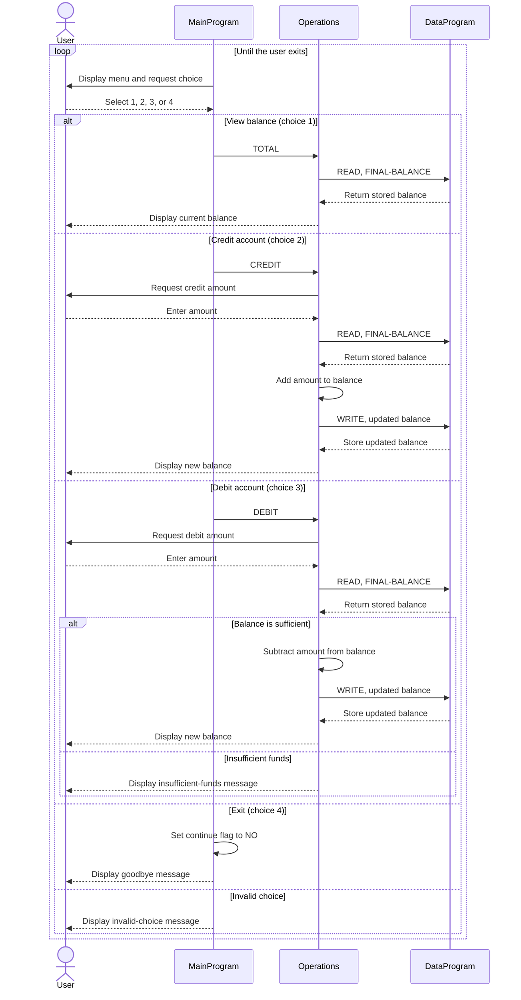

# COBOL Account Management System

This directory documents the COBOL account-management example in `src/cobol`. The program provides a console menu for viewing a balance, crediting an account, and debiting an account.

## Source files

| File | Purpose | Key behavior |
| --- | --- | --- |
| `src/cobol/main.cob` | Console entry point (`MainProgram`). | Displays the menu, accepts a choice, and calls `Operations` with `TOTAL`, `CREDIT`, or `DEBIT`. Choice 4 exits; other choices display an invalid-choice message. |
| `src/cobol/operations.cob` | Account operation handler (`Operations`). | Reads and displays the balance, accepts credit/debit amounts, applies the requested change, and reports the result. It rejects a debit when the available balance is too low. |
| `src/cobol/data.cob` | Balance storage interface (`DataProgram`). | Handles `READ` by returning the stored balance and `WRITE` by replacing it. The working-storage balance starts at `1000.00`. |

## Student account rules represented in the code

The source code does not define student records, student identifiers, account ownership, or student-specific policies. “Student account” therefore refers only to the generic account balance handled by this example; no student-specific behavior should be inferred.

The implemented balance rules are:

- The balance is initialized to `1000.00` when `DataProgram` starts.
- A credit adds the entered amount to the current balance.
- A debit is allowed only when the current balance is greater than or equal to the entered amount. Otherwise, the program displays an insufficient-funds message and leaves the balance unchanged.
- The balance and amounts use `PIC 9(6)V99`, representing up to six integer digits and two decimal digits. The implied decimal point is not displayed by these fields.
- The balance is held in working storage; the program does not save it to a file or database. It is not durable across program runs.

## Important limitations

The program does not validate that entered amounts are positive, enforce student eligibility or account limits, or check for a balance overflow after a credit. These are not implemented business rules and would need to be specified before adding student-account behavior.

## Sequence diagram

